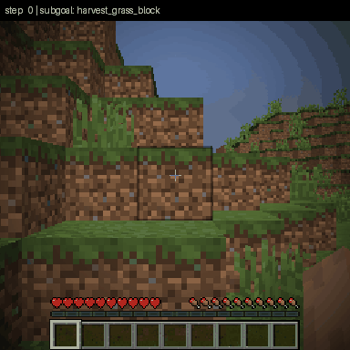

# EmbodiedMind

[](https://github.com/vishalchauhan-hi/embodied-mind/actions/workflows/tests.yml)

[](LICENSE)

A Minecraft agent that plans with a language model, sees with a vision-language model (VLM), and remembers past episodes. It runs on [MineDojo](https://minedojo.org/).

Each step the agent looks at the game frame, recalls similar past episodes, asks the planner for an ordered list of subgoals, and turns the current subgoal into a game action. At the end of an episode it writes a short lesson into its memory, so the next episode can use it.

<p align="center">
  
</p>
<p align="center"><sub>The agent on MineDojo <code>harvest_wood</code> with a local 7B model (<code>qwen2.5vl:7b</code>), first 150 steps. The bar shows the planner's current subgoal; this run drifts from trees to grass, crafting and crops (see <a href="#results">Results</a>).</sub></p>

## Status

- The full loop (perceive, recall, plan, act, reflect) runs end to end on real MineDojo, on Linux and on Apple Silicon Macs through Rosetta.
- Unit tests and an offline smoke benchmark run in CI on Python 3.9, 3.11 and 3.12.
- First MineDojo runs with a fully local 7B vision model are in under [Results](#results). The agent does not yet collect wood; larger models and longer runs are next.

## How it works

```
frame -> VLM perceiver -> scene description (things in view, their distance and direction)
                                   |
episodic memory -> recall similar past episodes
                                   |
LLM planner -> subgoals, e.g. find_tree, approach_tree, mine_log, craft_planks, ...
                                   |
action executor -> steer toward the target, mine, attack or craft
                                   |
MineDojo adapter -> MineDojo's 8-part action format
```

- `perceiver.py` sends the frame to a VLM (Gemini, OpenAI, or a local model such as `qwen2.5vl` through Ollama) and asks for JSON describing what is in view.
- `planner.py` asks an LLM for subgoals given the goal, the scene, the inventory, recent failures and recalled memories. A rule-based planner covers offline runs and API failures.
- `action_executor.py` turns a subgoal into an action. It steers toward targets using the direction and distance the VLM reported, and looks again after each turn.
- `memory.py` stores one entry per episode and recalls the closest ones by embedding similarity. It uses OpenAI embeddings when a key is set and an offline word-hashing embedding otherwise.
- `skills.py` keeps short action sequences for subgoals that do not depend on the scene, such as crafting, and stops using a skill when its success rate drops.
- `minedojo_adapter.py` converts readable actions into MineDojo's action array and flattens MineDojo observations.
- `mock_env.py` is a small offline stand-in for Minecraft, used for tests.

## Install

```bash
git clone https://github.com/vishalchauhan-hi/embodied-mind.git
cd embodied-mind
python -m venv .venv && source .venv/bin/activate
pip install -e ".[dev]"
pytest -q            # offline tests, no Minecraft or API key needed
```

For real runs you also need MineDojo, Java 8 and an API key. [docs/RUNNING.md](docs/RUNNING.md) covers Linux and Apple Silicon, including fixes for current MineDojo install problems (gym 0.21 metadata, NumPy 2, the missing MixinGradle build plugin).

## Run

Offline check that the whole loop works (no Minecraft, no API key):

```bash
python -m embodied_mind.evaluate --env mock --model rule --task_suite all --num_episodes 10
```

Real MineDojo run:

```bash
cp .env.example .env          # add GOOGLE_API_KEY or OPENAI_API_KEY
python -m embodied_mind.run --task harvest_wool --model gemini-3.8-flash --num_episodes 3
python -m embodied_mind.evaluate --task_suite harvest --model gemini-3.8-flash --num_episodes 5
```

Fully local run, no API key (a vision model served by [Ollama](https://ollama.com), for example on an Apple Silicon Mac):

```bash
ollama pull qwen2.5vl:7b
python -m embodied_mind.run --task harvest_wood --model ollama/qwen2.5vl:7b --num_episodes 1 --max_steps 500
```

`evaluate` runs every task with memory off and on and writes `results/benchmark.csv` and `results/benchmark.md`.

## Results

### MineDojo, local model

`harvest_wood` (MineDojo `harvest_1_log`) with `qwen2.5vl:7b` served by Ollama as both the perceiver and the planner, 500 steps per episode, seeds 42 onwards, on an M1 Max Mac under Rosetta. Memory on means each episode can recall the lessons written at the end of the earlier ones. Files are in [`results/memory_experiment/`](results/memory_experiment/).

| Setting | Episodes | Logs collected | Success |
|---|---|---|---|
| Memory off | 3 | 0 | 0 / 3 |
| Memory on | 2 | 0 | 0 / 2 |

The 7B model does not solve the task yet, with or without memory. Its plans name the right goal (go to the trees, harvest wood), but the agent spends its steps on grass, cacti, or crafting before it has any wood. Memory does what it is meant to do mechanically: the episode 1 reflection ("the failures occurred when attempting to harvest grass and cacti") was recalled in episode 2, whose first actions moved forward instead of crafting. Two episodes are far too few to say whether that helps. The runs were stopped early because each episode takes 1 to 2 hours on this machine.

Earlier runs with Gemini (`results/`, 500 steps each) say nothing about the LLM agent, because most API calls failed (a retired model, then the free-tier daily limit) and the agent ran on its rule fallback.

### Offline mock environment

The table below is from the offline mock environment, with the rule planner and 20 episodes per row. It shows that the loop runs end to end. It is not a MineDojo result and should not be read as one.

| Task | Success rate | Avg steps |
|---|---|---|
| harvest_wood | 100% | 55 |
| harvest_wool | 100% | 26 |
| harvest_cobblestone | 100% | 220 |
| craft_wooden_pickaxe | 100% | 164 |
| craft_stone_pickaxe | 100% | 459 |

Runs are seeded, so the same command gives the same numbers. Memory only changes what the LLM planner sees, so turning it on gives identical numbers with the rule planner. The memory comparison needs real MineDojo runs with an LLM.

## Project layout

```
embodied_mind/
  agent.py              main loop: perceive, recall, plan, act, reflect
  perceiver.py          VLM scene description
  planner.py            LLM and rule-based subgoal planning
  memory.py             episodic memory
  skills.py             skill library
  action_executor.py    subgoal -> action
  minedojo_adapter.py   MineDojo action and observation conversion
  mock_env.py           offline test environment
  run.py                run one task
  evaluate.py           benchmark across tasks, memory off and on
configs/default.yaml
prompts/perceiver.txt
docs/RUNNING.md
tests/test_agent.py
```

## References

- Fan et al., MineDojo: Building Open-Ended Embodied Agents with Internet-Scale Knowledge, NeurIPS 2022.
- Wang et al., Voyager: An Open-Ended Embodied Agent with Large Language Models, 2023.
- Liu et al., Odyssey: Empowering Minecraft Agents with Open-World Skills, IJCAI 2025.
- Lifshitz et al., STEVE-1: A Generative Model for Text-to-Behavior in Minecraft, 2023.

## Contact

Vishal Chauhan, Assistant Professor, The University of Tokyo
vishalutokyo@gmail.com, vishalchauhan@g.ecc.u-tokyo.ac.jp

## License

MIT, see [LICENSE](LICENSE).
